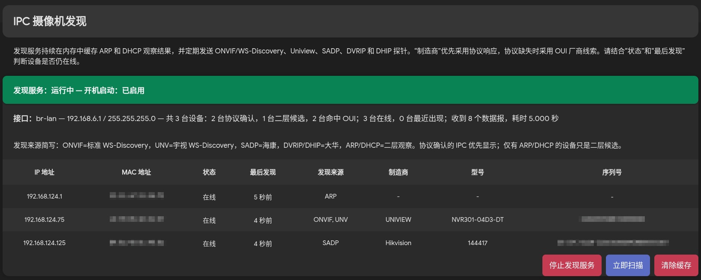

# OpenWrt IP Camera Discovery

OpenWrt IPC/安防设备发现工具。扫描器仅使用 Python 标准库；LuCI 采用 JavaScript view、rpcd/ucode 和最小权限 ACL。



## 1. 发现方式与准确性边界

主动发现共有五种：

| 协议 | 本地源端口 | 目的地址 | 目的端口 | 关键请求 |
|---|---:|---|---:|---|
| 标准 ONVIF WS-Discovery | 3705 | `239.255.255.250` | 3702 | `<tns:Probe>` |
| Uniview WS-Discovery 扩展 | 3705 | `255.255.255.255` 和接口定向广播 | 3702 | `<tns:UniviewProbe>` |
| Hikvision/SADP 风格 | 37020 | `239.255.255.250`、`ff02::c` | 37020 | `<Probe><Types>inquiry</Types>...` |
| Dahua DVRIP discovery | 5051，冲突时使用临时端口 | `255.255.255.255` | 5050 | 固定 32 字节 A3 查询 |
| Dahua DHIP discovery | 37809/37810/37811，冲突时使用临时端口 | `239.255.255.251` | 37810/37820/8087 | 32 字节 DHIP 头 + `DHDiscover.search` JSON |

现场响应有两个关键特征：

- ONVIF/Uniview 响应可能发送到 `255.255.255.255:3705`，而不只是单播返回。
- 响应 XML 常被拆成 IPv4 分片。程序使用普通 UDP socket，让 Linux 内核重组后再解析完整 XML。
- SADP 响应可能发到 `239.255.255.250:37020`，监听 socket 因此必须加入该组播组。
- Hikvision ConfigTool 还会向 IPv6 链路本地组播 `ff02::c:37020` 发送相同 SADP 查询；IPv6 不可用时程序自动保留 IPv4 路径。
- Dahua UDP/5050 返回的是 32 字节 B3 头、88 字节固定设备记录和文本尾部，不是加密载荷；响应发回查询的实际源端口，因此 5051 被占用时可安全退回临时端口。
- Dahua DHIP 的 32 字节 little-endian 头声明 JSON 和二进制区长度；程序只接受合法长度的 `client.notifyDevInfo`/`client.notifyDeviceInfo` 发现响应。

`test.pcap` 回归结果为：标准 ONVIF 发现 3 台、Uniview 发现 22 台、SADP 发现 1 台；按 MAC、序列号、Endpoint 和 IP 安全合并后共有 **23 台唯一的协议响应设备**。`hiktest.pcap` 可恢复 3 台 Hikvision 设备；`dahuatest.pcap` 中 DVRIP 与 DHIP 响应按 MAC 合并为 1 台 Dahua 设备。

守护进程还被动监听两种二层线索：

- ARP sender IP/MAC
- DHCP Discover client MAC，以及存在时的 Requested IP

准确性边界：只有解析到上述五种主动发现响应的条目才标记为 `camera` / `Protocol confirmed`；只有 ARP/DHCP 的条目标记为 `layer2-candidate` / `L2 candidate`。ARP/DHCP 只能证明设备在二层出现过，不能证明它是摄像机。现场抓包中四台不响应 WS-Discovery 的设备可通过 DHCP MAC 与后续 ARP IP 合并为 `192.168.10.2` 至 `192.168.10.5`，但仍保持候选标记。

程序内置 Dahua、Uniview、Hikvision/Prama Hikvision 的摄像机相关 OUI 提示，并可读取 `/etc/ipc-discovery/oui-camera.txt` 覆盖或扩展，格式为 `PREFIX|VENDOR`，例如：

```text
98:F9:CC|Dahua
AA-BB-CC|Custom Vendor
```

OUI 命中会写入独立的 `oui_vendor` 字段；LuCI 的“制造商”列优先显示协议 Manufacturer，协议未提供时显示 OUI 回退值。为避免误判，OUI 只是一条 MAC 厂商线索：即使命中摄像机厂商 OUI，只有 ARP/DHCP 的设备仍然是 `L2 candidate`。来源记录在 `manufacturer_source`，完整字段继续保留在 JSON API 中。

## 2. 缓存与在线状态

`ipc-discovery --daemon` 持续监听并缓存结果，默认行为如下：

- 每 30 秒发送一次主动探针。
- LuCI 的“立即扫描”发送 2 轮探针并等待 5 秒。
- `last_seen_ms` 记录最近一次有效协议响应、ARP 或 DHCP 观察时间。
- `age_ms <= 60 秒` 标记为 `online`。
- `60 秒 < age_ms <= 300 秒` 标记为 `recent`。
- 超过 300 秒自动从缓存删除。
- 同时有 MAC 的条目只按相同 MAC 合并，避免相同 IP、不同设备被误合并；同一 MAC 后续出现新 IP 时更新为新 IP。

所有发现结果仅保存在 daemon 进程内存中，不写入 UCI、JSON、数据库、浏览器存储或其他持久化文件。daemon 重启即清空全部结果。运行时 Unix socket 和空 lock 文件位于 `/var/run`；OpenWrt 的 `/var` 指向 `/tmp`，因此它们也在 tmpfs。`/etc/ipc-discovery/oui-camera.txt` 是静态匹配规则，不包含发现结果。

daemon 使用单线程 `select` 事件循环，所有 socket 接收、缓存合并、清理和 RPC 请求在同一线程内串行执行，不存在跨线程共享缓存。进程级 `flock` 阻止 daemon 与一次性扫描重叠运行；每个可读 socket 和监听 socket 每轮都有处理上限，避免广播风暴或连接突发长期饿死其他协议及扫描截止时间。多源身份记录会执行传递式合并，最新时间戳的 IP 优先，具体厂商名优先于 `General`/`Private` 等泛化值。

LuCI 页面只按 IP 地址从小到大排列所有设备，设备分类和 `last_seen_ms` 均不参与排序。页面显示状态、以“N 秒前”表示的最后发现、发现来源简写、制造商、型号和序列号，并在表格上方说明各来源缩写；页面不显示设备名称，后端 `name` 字段仍保留。分类列当前保留为注释；OUI 厂商、固件和服务地址仍隐藏，后端 JSON 字段不受影响。页面提供“清除缓存”按钮；清空仅删除当前缓存，之后新收到的网络报文仍会重新建立条目。

LuCI 还提供 **Stop daemon / Start daemon** 开关。停止会同时执行 `stop + disable`：进程退出、不再抓包或发送探针、内存缓存立即消失，路由器重启后也不会自动启动。启动会执行 `enable + start` 并恢复开机启动。页面检测到 daemon 已停止时不会自动触发扫描，因此停止状态没有 scanner CPU 开销。

### 性能基线

在客户当前路由器上以 `br-lan` 运行、空闲采样 10 秒：v1.1.3 进程为单线程、8 个文件描述符，RSS 约 13.6 MB；CPU 增量为 22 ticks，设备的 `SC_CLK_TCK=100`，即约占单个 CPU 核心 2.2%。v1.1.4 默认每轮最多发送 10 个 UDP 数据报，30 秒周期下平均带宽仍不足 2 kbps；主要开销来自 `AF_PACKET` 对 `br-lan` 二层流量的头部筛选，因此高吞吐或广播风暴环境中的 CPU 使用率会随包速率上升。缓存条目上限可用 `max_entries` 控制。

## 3. 依赖

命令行及守护进程需要：

```text
python3-light
python3-xml
```

LuCI 页面另需 `luci-base`。脚本不依赖 Scapy、libpcap、lxml、pip、`python3-uuid` 或 `python3-urllib`。

```sh
# APK 系 OpenWrt
apk update
apk add python3-light python3-xml

# opkg 系 OpenWrt
opkg update
opkg install python3-light python3-xml
```

ARP/DHCP 监听使用 Linux `AF_PACKET`，主动探测的接口绑定也需要 root。OpenWrt 的 procd 服务和 rpcd 通常均以 root 运行。

## 4. 文件

- `ipc-discovery.py`：独立扫描器、缓存守护进程和本地 Unix socket 客户端。
- `luci-app-ipc-discovery/`：LuCI package，包含 procd、UCI、scanner、页面、RPC 和 ACL。
- `install-openwrt.sh`：无需重编固件的直接安装脚本。
- `uninstall-openwrt.sh`：停止服务并卸载直接安装的文件。
- `SHA256SUMS`：发布文件校验值。

## 5. 命令行使用

查看可用的 L3 device：

```sh
ipc-discovery --list-interfaces
```

执行一次性扫描：

```sh
ipc-discovery --interface br-lan --json --pretty
```

手工运行守护进程：

```sh
ipc-discovery --daemon --interface br-lan
```

查询缓存、触发 5 秒扫描和清空缓存：

```sh
ipc-discovery --client status --json --pretty
ipc-discovery --client scan --json --pretty
ipc-discovery --client clear --json --pretty
```

不经过 LuCI 时可使用等价的服务命令：

```sh
/etc/init.d/ipc-discovery stop
/etc/init.d/ipc-discovery disable

/etc/init.d/ipc-discovery enable
/etc/init.d/ipc-discovery start
```

守护进程默认 Unix socket 为 `/var/run/ipc-discovery.sock`，权限为 `0600`。主要参数：

```text
-i, --interface DEVICE       L3 device，默认优先 br-lan
-t, --timeout SECONDS        一次性扫描接收窗口，默认 4 秒
-r, --retries N              每次立即扫描的探针轮数，默认 2
--probe-interval SECONDS     守护进程周期探针间隔，默认 30 秒
--scan-wait SECONDS          客户端 scan 等待窗口，默认 5 秒
--online-window SECONDS      online 时间窗，默认 60 秒
--cache-ttl SECONDS          缓存淘汰时间，默认 300 秒
--max-entries N              最大缓存条目，默认 4096
--oui-file PATH              OUI 扩展文件，默认 /etc/ipc-discovery/oui-camera.txt
--socket PATH                自定义守护进程 socket
--no-onvif                   禁用 ONVIF 和 Uniview
--no-uniview                 仅禁用 Uniview 扩展
--no-sadp                    禁用 SADP
--no-dahua                   禁用 Dahua DVRIP 和 DHIP
```

JSON 结果级字段包括 `camera_count`、`candidate_count`、`oui_match_count`、`online_count`、`recent_count`、`arp_packets` 和 `dhcp_packets`。设备级字段包括 `classification`、`classification_basis`、`oui_vendor`、`manufacturer_source`、`presence`、`last_seen_ms`、`age_ms`、`protocols`、IP/MAC 和主动发现元数据。

## 6. 直接安装 LuCI

把整个目录复制到路由器后执行：

```sh
cd /tmp/ipc-discovery-openwrt
./install-openwrt.sh
```

安装脚本会保留已经存在的 `/etc/config/ipc-discovery`，安装并启动 procd 服务。默认 UCI 配置：

```uci
config main 'main'
	option interface 'br-lan'
	option probe_interval '30'
	option scan_wait '5'
	option online_window '60'
	option cache_ttl '300'
	option max_entries '4096'
	option oui_file '/etc/ipc-discovery/oui-camera.txt'
```

修改后重载服务：

```sh
uci set ipc-discovery.main.interface='br-camera'
uci commit ipc-discovery
/etc/init.d/ipc-discovery reload
```

LuCI 入口：`Network -> IP Camera Discovery`。RPC 验证：

```sh
ubus list luci.ipc-discovery -v
ubus call luci.ipc-discovery status
ubus call luci.ipc-discovery scan
ubus call luci.ipc-discovery clear_cache
ubus call luci.ipc-discovery daemon_status
ubus call luci.ipc-discovery daemon_stop
ubus call luci.ipc-discovery daemon_start
```

## 7. 作为 LuCI package 构建

```sh
cp -a luci-app-ipc-discovery \
    OPENWRT/feeds/luci/applications/luci-app-ipc-discovery
cd OPENWRT
./scripts/feeds update luci packages
./scripts/feeds install -a
make menuconfig
make package/feeds/luci/luci-app-ipc-discovery/compile V=s
```

Makefile 声明了 `luci-base`、`python3-light` 和 `python3-xml` 依赖。

## 8. 网络、防火墙和安全

1. 发现报文是链路本地广播/组播，不会自然跨越三层路由或 VLAN。应在摄像机所在广播域对应的 L3 device 上运行。
2. camera firewall zone 若为 `input REJECT/DROP`，需允许到路由器本机 UDP 3705、37020、5051、37809-37811（固定端口冲突时还需允许连接跟踪的临时回包），并允许路由器发出 UDP 3702、37020、5050、37810、37820 和 8087。
3. 组播 TTL 为 1，并使用 `SO_BINDTODEVICE` 限制接口。内核会把 `239.255.255.250` 正确映射为目的 MAC `01:00:5e:7f:ff:fa`。
4. 已有进程占用 UDP 3705 或 37020 时，对应监听会产生 warning；Dahua 固定源端口被占用时自动使用临时端口。未受影响的协议和二层监听仍继续工作。
5. 所有发现元数据均来自未认证网络。LuCI 用 Text node 显示设备字段以避免 HTML/JavaScript 注入；URL 仅在 `http://` 或 `https://` 时可点击。
6. 工具只做资产发现，不登录设备，不验证口令，不做激活、改 IP、密码重置或漏洞探测。
